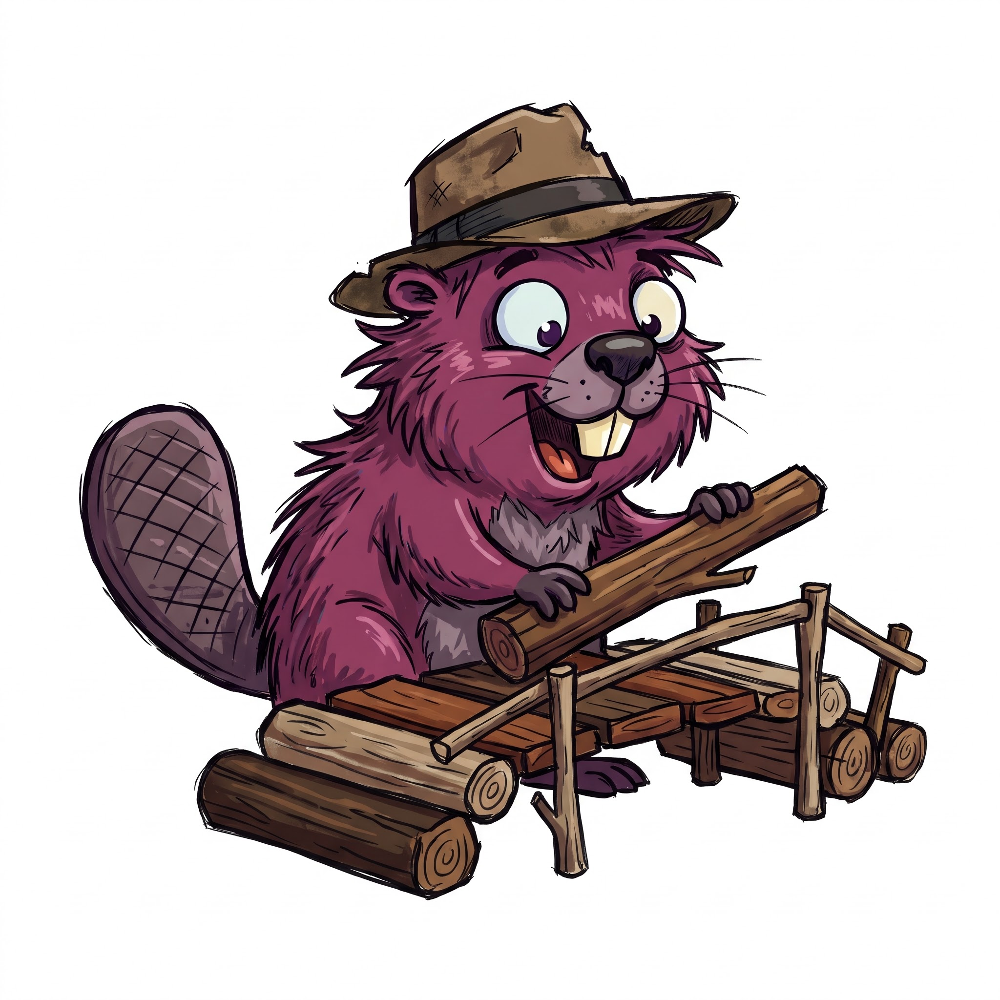

# BeaverBridge — colour palette and typography

Proposal, derived from the logo (a plum-purple beaver with a weathered brown hat, building a log bridge). Status: **Vorschlag**, to be confirmed when the first page is built (S7).



## Where the colours come from

| Logo element | Colour in the logo (approx.) | Role in the palette |
|---|---|---|
| Fur | plum / magenta-purple | **Primary** |
| Hat, logs, planks | warm browns | **Wood** (secondary) |
| Tongue | coral red | **Coral** (accent, warnings) |
| Teeth | cream yellow | **Cream** (highlights) |
| Eyes | pale blue-grey | **Info** (links to external things, notes) |
| Muzzle, tail | mauve grey | neutrals, borders |

The neutrals are tinted towards the plum, so pages look like part of the logo and not like a default grey theme.

## Light mode

| Token | Hex | Use |
|---|---|---|
| `--bg` | `#FBF7F4` | page background |
| `--surface` | `#FFFFFF` | cards, tables |
| `--surface-alt` | `#F3EBE6` | zebra rows, code blocks, property boxes |
| `--text` | `#2B1B24` | body text |
| `--text-muted` | `#6A5560` | captions, metadata |
| `--border` | `#E0D2CA` | lines, table borders |
| `--primary` | `#8E3A63` | buttons, headings, active facet |
| `--primary-hover` | `#742E50` | hover, pressed |
| `--on-primary` | `#FFFFFF` | text on primary |
| `--link` | `#7A3157` | links |
| `--wood` | `#7A5B3A` | secondary accent, instance badges |
| `--coral` | `#C04A35` | warnings, SHACL violations |
| `--cream` | `#F2E3B0` | highlight background (search hits) |
| `--info` | `#2F6F7A` | notes, external links |

## Dark mode

| Token | Hex | Use |
|---|---|---|
| `--bg` | `#1C1218` | page background |
| `--surface` | `#271A22` | cards, tables |
| `--surface-alt` | `#33232D` | zebra rows, code blocks |
| `--text` | `#F3E9EE` | body text |
| `--text-muted` | `#BBA6B1` | captions, metadata |
| `--border` | `#4A3643` | lines, table borders |
| `--primary` | `#D777A6` | buttons, headings, active facet |
| `--primary-hover` | `#E597BD` | hover, pressed |
| `--on-primary` | `#1C1218` | text on primary |
| `--link` | `#E39BC1` | links |
| `--wood` | `#C9A27A` | secondary accent, instance badges |
| `--coral` | `#F0866F` | warnings, SHACL violations |
| `--cream` | `#F2E3B0` | highlight (use dark text on it) |
| `--info` | `#6FC0CC` | notes, external links |

In dark mode the primary is the *lightened* plum, not the logo plum: the original fur colour is too dark against a dark background.

## Contrast (WCAG 2.1, computed)

| Pair | Light | Dark |
|---|---|---|
| text on background | 15.3 : 1 | 15.4 : 1 |
| muted text on background | 6.4 : 1 | 8.0 : 1 |
| link on background | 8.2 : 1 | 8.5 : 1 |
| primary on background | 6.7 : 1 | 6.2 : 1 |
| text on primary button | 7.2 : 1 | 6.2 : 1 |
| wood on background | 5.8 : 1 | 7.8 : 1 |
| coral on background | 4.6 : 1 | 7.3 : 1 |
| info on background | 5.4 : 1 | 8.8 : 1 |

All pairs reach AA (4.5 : 1) for normal text.

## Typography

The sibling sites (`fuzzy-sl-static`, `chublets-wikibase-demo`) use the system stack `"Helvetica Neue", Arial, Helvetica, sans-serif` and `ui-monospace` for code. Both are archive-safe: no web font to load, so a copy of the repository still renders the same in ten years. The proposal keeps that and adds one optional heading font.

| Role | Proposal | Fallback stack |
|---|---|---|
| Body | system sans (as in the family) | `"Helvetica Neue", Arial, Helvetica, sans-serif` |
| Headings | **Bitter** (slab serif, echoes logs and planks), optional, self-hosted | `Georgia, "Times New Roman", serif` |
| Code, IRIs | system monospace (as in the family) | `ui-monospace, "SFMono-Regular", Menlo, Consolas, monospace` |

Rules: no font from a CDN (the pages must not call third parties); if Bitter is used, its WOFF2 file is committed to `docs/assets/fonts/` (SIL Open Font Licence). Without it the heading stack falls back to Georgia and nothing breaks.

## CSS tokens

```css
:root {
  --bg: #FBF7F4;  --surface: #FFFFFF;  --surface-alt: #F3EBE6;
  --text: #2B1B24;  --text-muted: #6A5560;  --border: #E0D2CA;
  --primary: #8E3A63;  --primary-hover: #742E50;  --on-primary: #FFFFFF;
  --link: #7A3157;  --wood: #7A5B3A;  --coral: #C04A35;
  --cream: #F2E3B0;  --info: #2F6F7A;
  --font-body: "Helvetica Neue", Arial, Helvetica, sans-serif;
  --font-head: Bitter, Georgia, "Times New Roman", serif;
  --font-mono: ui-monospace, "SFMono-Regular", Menlo, Consolas, monospace;
}
@media (prefers-color-scheme: dark) {
  :root:not([data-theme="light"]) {
    --bg: #1C1218;  --surface: #271A22;  --surface-alt: #33232D;
    --text: #F3E9EE;  --text-muted: #BBA6B1;  --border: #4A3643;
    --primary: #D777A6;  --primary-hover: #E597BD;  --on-primary: #1C1218;
    --link: #E39BC1;  --wood: #C9A27A;  --coral: #F0866F;
    --cream: #F2E3B0;  --info: #6FC0CC;
  }
}
:root[data-theme="dark"] {
  --bg: #1C1218;  --surface: #271A22;  --surface-alt: #33232D;
  --text: #F3E9EE;  --text-muted: #BBA6B1;  --border: #4A3643;
  --primary: #D777A6;  --primary-hover: #E597BD;  --on-primary: #1C1218;
  --link: #E39BC1;  --wood: #C9A27A;  --coral: #F0866F;
  --cream: #F2E3B0;  --info: #6FC0CC;
}
```

The `data-theme` attribute lets a toggle button override the system setting; without it the page follows `prefers-color-scheme`.

## Diagrams

Mermaid diagrams keep the colour scheme fixed in the project preferences (subject/object grey, class dark orange, term dark purple, and so on). They are **not** recoloured with this palette, so diagrams look the same in every repository of the family.

## Open

- Does the logo need a transparent or dark-mode variant? The current JPG has a white background and will show as a white box on `--bg` in dark mode.
- Bitter yes or no, decided with the first page in S7.
